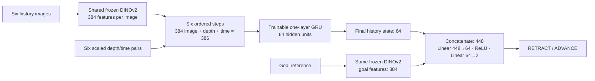
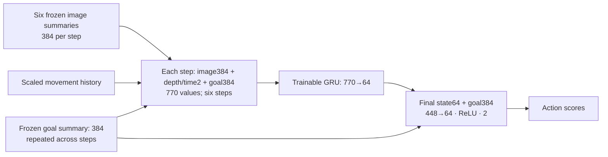
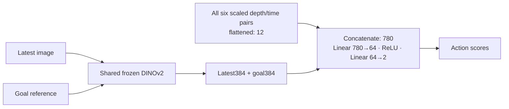
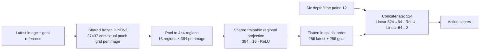
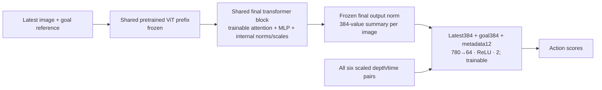
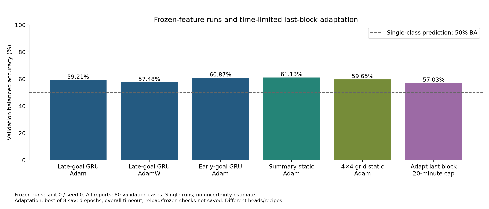
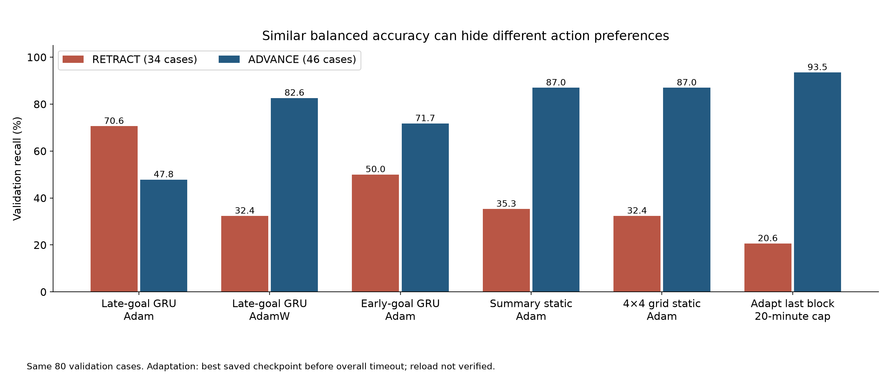

# Vision Transformer Models for Guidewire Action Prediction

## Current poster handoff

The [first Google Doc tab](https://docs.google.com/document/d/1O2SfqUBcanN61GzJZBzdgv33XBrKP_5Z1KFOZf46p2A/edit?tab=t.4uk3lnqxhsj2) is the edited presentation destination. Tran’s section covers six successive experiments and five major architectures; AdamW shares the baseline diagram. The section alone must remain within three pages. Export inspection confirmed that fit, and readback preserved Sabrina’s text/image identities. The narrative emphasizes why evidence led to the next intervention, with selective rounded metrics. This file retains the fuller evidence reference.

[Architecture diagrams](figures/architectures.png) accompany the comparison chart. The editable source is `draw_architectures.swift` (macOS AppKit); from the repository root run `swift tran/draw_architectures.swift`. Numerical charts are regenerated with `python tran/plot_aggregate_metrics.py` using matplotlib and NumPy. No private cases or model weights are required.

## Research question

Can a pretrained vision transformer predict ADVANCE or RETRACT from the goal reference and recent observations? Does visual history improve prediction, or can a simpler model perform similarly?

We compared a temporal model, earlier goal conditioning, a latest-image classifier, a spatial-grid classifier and limited encoder fine-tuning. Across the completed frozen-encoder experiments, selected validation balanced accuracy ranged from **57.48% to 61.13%**. No clear benefit from added temporal or spatial complexity emerged. This motivates investigating the visual features themselves, alongside overfitting and class imbalance.

## Task and data

Each decision includes a **target-marked goal reference, six chronological images, and relative depth/time history**. The goal is separate from the six-frame sequence. Labels represent inferred operator actions rather than verified optimal actions.

The dataset contains **416 decisions from 120 episodes**: 259 ADVANCE and 157 RETRACT. Development experiments use **267 training, 80 validation and 69 reserved test cases**, with episodes separated across partitions. Validation contains 34 RETRACT and 46 ADVANCE cases.

We report accuracy, cross-entropy loss, balanced accuracy and both class recalls. **Balanced accuracy is the average of RETRACT and ADVANCE recall**; a model predicting only one class scores 50%. Class-level reporting matters because overall accuracy can hide poor RETRACT performance.

## Model architectures

### Shared visual encoder

We use pretrained **DINOv2 Small/14** to turn each image into a **384-dimensional feature vector**. Images retain their full field of view through proportional resize and padding to 518×518. The target marker is preserved. Depth/time history is scaled using training data only.

The first five models keep the image encoder frozen and train the downstream predictor. This reduces training cost and lets us compare how the same visual representation is used. The final experiment trains the last transformer block as well.

### Baseline: ViT–GRU with late goal fusion

The GRU processes six ordered image-feature vectors with their matching depth/time values. Its final 64-dimensional memory is combined with the goal vector, then a small classifier predicts the action. The goal enters after the history has been summarized. **Trainable parameters: 115,650.**

### Goal-conditioned GRU

The goal vector is supplied at every history step and again to the final classifier. This allows the target to influence memory updates. The GRU remains 64-dimensional, but the larger input increases trainable parameters to **189,378**.

### Latest-image classifier without a GRU

The classifier receives the latest image vector, goal vector and all six depth/time pairs. It removes earlier visual frames and recurrence while retaining numerical movement history. The **780→64→2** classifier has **50,114 trainable parameters**.

### Spatial-grid classifier without a GRU

Instead of one summary per image, we pool patch features into a **4×4 spatial grid**. A shared projection compresses each region before the latest-image and goal grids are combined with movement metadata. The model has **39,890 trainable parameters**. It exposes coarse location but does not explicitly detect the wire or match it to the target.

### Last-block fine-tuning

We train the final transformer block and retain the same latest-image classifier. Earlier encoder layers remain frozen. This tests whether adapting visual features to the task helps, without adding temporal processing.

## Baseline training and validation

The baseline uses a frozen encoder and a one-layer, 64-unit GRU. Training uses Adam, learning rate 0.001, batch size 32 and unweighted cross-entropy. Validation balanced accuracy selects the checkpoint; early stopping limits continued fitting. The other frozen comparisons retain this recipe except for the designated AdamW experiment.

At the selected baseline checkpoint:

- **Training:** 84.27% accuracy, 87.20% balanced accuracy, **0.35353 loss**.
- **Validation:** 57.50% accuracy, 59.21% balanced accuracy, **0.90499 loss**.
- **Validation recalls:** 70.59% RETRACT and 47.83% ADVANCE.

Training loss continued falling while validation loss increased. By the final epoch, training balanced accuracy was approximately **98.8%**, compared with **52.2%** on validation. This is a substantial generalization gap. An earlier eight-example check reached 100% training accuracy, confirming that the model could learn training examples, rather than establishing useful held-out performance.

## Hypotheses and experimental progression

### 1. Can regularization reduce overfitting?

**Change:** keep the late-goal GRU and switch from Adam to AdamW with weight decay 0.01.

**Result:** selected training BA **74.75%**, validation BA **57.48%**. Training/validation loss: **0.46257 / 0.80083**. Validation accuracy increased to **61.25%**, but RETRACT recall dropped to **32.35%** while ADVANCE recall rose to **82.61%**.

**Insight:** reducing training fit and the train/validation gap did not improve balanced performance. Higher ordinary accuracy concealed a shift toward the majority action. This single optimizer/decay comparison does not rule out regularization generally.

### 2. Does the model need the goal while processing history?

**Change:** provide the goal at every GRU step, retaining the final goal connection.

**Result:** validation accuracy **62.50%**, BA **60.87%**, loss **0.90423**; recalls **50.00% RETRACT / 71.74% ADVANCE**. The learning curves still show overfitting.

**Insight:** earlier goal access produced a small selected improvement over the original GRU, but increased parameter count as well. It does not establish better target reasoning or a reliable generalization gain.

### 3. Does processing all six images help?

**Change:** remove the GRU and use the latest image, goal and full numerical movement history in a small classifier.

**Result:** validation accuracy **65.00%**, BA **61.13%**, loss **0.85136**; recalls **35.29% RETRACT / 86.96% ADVANCE**.

**Insight:** balanced accuracy was almost identical to the early-goal GRU, despite removing visual sequence processing. We have not demonstrated that the six-image sequence adds predictive value in these models. The static model still uses movement history, so this is not evidence that all history is unnecessary.

**Trade-off:** the static model encodes two images instead of seven and has fewer trainable parameters. A matched inference benchmark is still needed to quantify the speed difference.

### 4. Are whole-image summaries losing useful spatial detail?

**Change:** replace the image summaries with coarse 4×4 regional features from the latest image and goal.

**Result:** selected training accuracy **67.79%**, BA **58.10%**, loss **0.59684**; validation accuracy **63.75%**, BA **59.65%**, loss **0.65845**.

**Insight:** the grid did not improve over summary-static. The validation difference amounts to **one fewer correctly predicted RETRACT case**, with the same ADVANCE count. Coarse pooling and regional compression may still obscure fine wire–target relationships; one run does not establish that spatial features are unhelpful.

Continued training increased training BA to **69.67%** while validation BA fell to **57.48%**. Later overfitting is evident, although the selected checkpoint itself did not have a positive training/validation BA gap.

### 5. Can adapting the visual encoder improve task features?

**Change:** unfreeze the final ViT block while keeping the latest-image classifier. The implemented recipe uses a lower encoder learning rate than the classifier to constrain changes to pretrained features.

**Result:** the run reached its **20-minute overall limit**, with eight epochs saved. The best saved checkpoint had:

- **Training:** 64.79% accuracy, 53.32% BA, **0.65521 loss**.
- **Validation:** 62.50% accuracy, 57.03% BA, **0.66737 loss**.
- **Validation recalls:** 20.59% RETRACT and 93.48% ADVANCE.

By the last saved epoch, validation BA fell to **52.24%** while validation loss rose to **0.68086**. An earlier, shorter attempt ended before any scored epoch.

**Insight:** this time-limited adaptation recipe did not outperform the frozen-static reference. Strong ADVANCE preference and training BA near 53% show weak balanced discrimination within the available training budget. The result does not establish convergence or rule out fine-tuning. Final checkpoint reload and frozen-layer checks were not recorded before termination.

## What we learned about visual features

**Working hypothesis:** the pretrained visual representation may not expose the task-specific information needed by a small predictor. Changing the temporal model, goal-conditioning stage and spatial pooling did not produce a convincing validation improvement, which motivates testing the shared encoder assumption.

A preliminary one-frame masking check also did not show greater embedding sensitivity to the wire-tip region than to background controls. This is limited supporting motivation, not evidence that the encoder fails to represent the wire.

**What is established:** the tested models struggle to generalize; visual-history processing has not demonstrated a clear advantage; class preferences vary substantially between models.

**What remains open:** whether the main limitation is visual representation, the small number of independent episodes, feature fusion, optimization, class imbalance or ambiguity in operator-action labels. Passing loading and feature-extraction checks does not guarantee useful features, but these results also do not identify a data-extraction bug.

## Trade-offs and interpretation

- **Temporal modeling:** ordered visual history provides motion context, but adds encoding cost and model complexity without a demonstrated gain here.
- **Goal conditioning:** earlier access may help relate observations to the target, but also increases capacity and overfitting risk.
- **Spatial representation:** regional features retain coarse position; pooling and compression may still remove fine detail, and position alone does not establish anatomical correspondence.
- **Frozen versus adapted features:** freezing makes experiments cheaper; adaptation can specialize features but requires more training and may amplify memorization.
- **Accuracy versus class balance:** the static model's 65% accuracy includes only 35% RETRACT recall. Both recalls and loss are necessary to interpret performance.
- **Strength of evidence:** one development split, one seed and repeated selection on 80 validation cases limit conclusions from small score differences. Test data remain reserved.

## Figures and data for presentation

### Validation performance across iterations

[Vector figure](figures/validation_balanced_accuracy.svg). **Caption:** Five frozen-encoder models reach 57.48–61.13% selected validation BA. Last-block adaptation reaches 57.03% at its best saved checkpoint before the time limit. These are individual development runs with different architectures and training budgets.

### Class-level trade-offs

[Vector figure](figures/validation_class_recalls.svg). **Caption:** Similar balanced accuracy can conceal different action preferences. The original GRU recovers more RETRACT cases; the static and adapted models strongly favor ADVANCE.

### Training versus validation

[Training/validation comparison](figures/selected_train_validation.png) · [Vector version](figures/selected_train_validation.svg).

Selected training measurements have now been filled from the supplied saved-epoch CSV, and this figure has been regenerated. The individual Google Sheets learning curves show **ordinary training and validation accuracy and loss against epoch**; balanced accuracy is not substituted.

Available aggregate data: [selected checkpoint metrics](selected_metrics.csv), [additional reported snapshots](additional_snapshots.csv), and [confusion counts](confusion_counts.csv). All six saved histories have now been processed on Perlmutter into individual accuracy/loss SVGs and a combined epoch-metrics CSV. Tran subsequently supplied the aggregate epoch CSV locally. All 305 epoch pairs were validated and logged in the approved six Google Sheets detail tabs, and previously missing selected-training values were filled in the local aggregate data.

### Individual training and validation learning curves

All six accuracy/loss SVGs and `epoch-metrics.csv` were generated from the saved histories on Perlmutter. Their shared directory is `$PSCRATCH/waldo-poster/accuracy-loss/`.

- `baseline-gru-adam-accuracy-loss.svg` — 73 saved epochs.
- `gru-adamw-accuracy-loss.svg` — 52 saved epochs.
- `early-goal-gru-accuracy-loss.svg` — 72 saved epochs.
- `summary-static-accuracy-loss.svg` — 62 saved epochs.
- `spatial-grid-accuracy-loss.svg` — 38 saved epochs.
- `lastblock-adaptation-accuracy-loss.svg` — 8 saved epochs; time-limited.

Each graph shows training and validation accuracy and loss, with a dashed line at the best saved validation-balanced-accuracy epoch. Accuracy is plotted as a fraction. Existing per-run loss/BA SVGs are also available for all six models. Generation is confirmed by Tran's terminal output; the new SVGs have not yet been visually inspected by the assistant. The combined CSV contains epoch-level aggregate metrics, not case-level predictions. These files remain on Perlmutter; no additional Google Sheets write is approved or performed by generating them.

### Per-model validation confusion matrices

Each figure shows true versus predicted actions at the selected checkpoint. All use the same count scale for comparison; the adaptation figure is labeled time-limited.

- [Original GRU / Adam](figures/confusion_gru-adam.png) · [SVG](figures/confusion_gru-adam.svg)
- [GRU / AdamW](figures/confusion_gru-adamw.png) · [SVG](figures/confusion_gru-adamw.svg)
- [Early-goal GRU](figures/confusion_gru-early-goal.png) · [SVG](figures/confusion_gru-early-goal.svg)
- [Summary-static](figures/confusion_static-latest.png) · [SVG](figures/confusion_static-latest.svg)
- [Spatial-grid static](figures/confusion_static-grid.png) · [SVG](figures/confusion_static-grid.svg)
- [Last-block adaptation](figures/confusion_lastblock-static.png) · [SVG](figures/confusion_lastblock-static.svg)

### Shared data log

[Local aggregate epoch data](epoch-metrics.csv) is the source for the completed Google Sheets logging. It contains 305 saved epochs, each with training/validation aggregate metrics; no case-level records or predictions.

- [tran - baseline gru](https://docs.google.com/spreadsheets/d/1I2OaiuCOtju8X4itgG5xOkOtONmJicPn2IszQRLDabU/edit#gid=1654700101) — 73 epochs; accuracy and loss charts.
- [tran - gru adamw](https://docs.google.com/spreadsheets/d/1I2OaiuCOtju8X4itgG5xOkOtONmJicPn2IszQRLDabU/edit#gid=1654700102) — 52 epochs; accuracy and loss charts.
- [tran - early goal gru](https://docs.google.com/spreadsheets/d/1I2OaiuCOtju8X4itgG5xOkOtONmJicPn2IszQRLDabU/edit#gid=1654700103) — 72 epochs; accuracy and loss charts.
- [tran - summary static](https://docs.google.com/spreadsheets/d/1I2OaiuCOtju8X4itgG5xOkOtONmJicPn2IszQRLDabU/edit#gid=1654700104) — 62 epochs; accuracy and loss charts.
- [tran - spatial grid](https://docs.google.com/spreadsheets/d/1I2OaiuCOtju8X4itgG5xOkOtONmJicPn2IszQRLDabU/edit#gid=1654700105) — 38 epochs; accuracy and loss charts.
- [tran - lastblock adaptation](https://docs.google.com/spreadsheets/d/1I2OaiuCOtju8X4itgG5xOkOtONmJicPn2IszQRLDabU/edit#gid=1654700106) — 8 epochs; accuracy and loss charts.

Each detail tab follows the template: Epoch, Training Accuracy, Training Loss, Validation Accuracy, Validation Loss. Values were read back and matched exactly to the CSV; 12 chart objects were confirmed. Native chart rendering remains unverified. Adaptation is labeled time-limited. The [earlier summary tab](https://docs.google.com/spreadsheets/d/1I2OaiuCOtju8X4itgG5xOkOtONmJicPn2IszQRLDabU/edit#gid=1654700001) remains an overview; its previously blank values were not updated during the epoch import. Future spreadsheet edits require a proposal and explicit approval.

## Future work

1. **Investigate task-specific visual features.** Review the limited fine-tuning result and weak training class balance before extending it. Compare a narrower adaptation or a different pretrained representation under controlled inputs and evaluation.
2. **Improve how image and goal information interact.** Test spatial pooling or explicit current–goal comparison that preserves relevant detail, changing one component at a time.
3. **Address generalization and class imbalance.** Evaluate smaller or regularized predictors and carefully justified class weighting; distinguish improved class balance from improved visual features.
4. **Establish robustness and efficiency.** Repeat promising comparisons under an agreed split/seed protocol, inspect errors and measure full per-decision latency on a single GPU before final test reporting.

These are proposed directions. No alternative pretrained model or customization has yet been established as better for this task.
